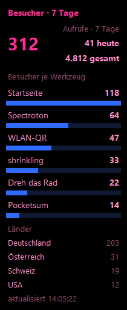

# Besucher-Ticker 📊

**Deine Besucherzahlen im Blick, während du arbeitest.** Eine kleine schwebende Anzeige für Windows, die die Zahlen der eigenen [GoatCounter](https://www.goatcounter.com)-Seite live zeigt: Seitenbesuche oder Kachel-Klicks im gewählten Zeitraum, Balken je Werkzeug, dazu Länder oder Verweise. Schwarz, pinke Schrift, blaue Balken.

   

[English version](README.md)



---

## Wofür

Das GoatCounter-Dashboard ist zum Hinsetzen und Anschauen. Diese Anzeige hier ist zum Nebenherlaufen: Sie steht in einer Bildschirmecke und beantwortet, ohne dass du eine Seite öffnest: *Wie viele waren da, und wo waren sie?*

## Voraussetzung

Eine eigene Webseite, die mit GoatCounter zählt. Der Ticker zählt selbst nichts, er zeigt an, was dein GoatCounter-Konto schon weiß. Ohne Konto zeigt er folgerichtig gar nichts.

## Was angezeigt wird

| | |
|---|---|
| **Große Zahl** | die Summe im gewählten Zeitraum (heute / 7 Tage / 30 Tage / gesamt), daneben der Heute- und der Gesamtwert |
| **Balken** | ein Balken je Werkzeug, so viele du willst (3 bis 20 oder alle). Unterseiten werden ihrer Seite zugeschlagen, Mini-Kacheln ihrer Kachel |
| **Zusatzblock** | wahlweise Länder oder Verweise, oder aus |

**Was gezählt wird** (Tray-Menü → **Zählweise**):

| | |
|---|---|
| **Seitenbesuche** | Besucher je Seite. Klick-Ereignisse bleiben draußen, sie sind keine Seiten |
| **Kachel-Klicks** | nur Ereignisse, deren Name mit `kachel-` beginnt: `kachel-ram` für einen Klick auf eine Kachel, `kachel-ram-anleitung` für eine Mini-Kachel darin. So meldet die [Werkstatt](https://dennismit2n.github.io/) seit dem 12. November 2026 Klicks auf ihre Kacheln, und sonst nichts. Der Balken heißt wie der Titel, den die Seite mitschickt |
| **automatisch** (Standard) | Kachel-Klicks, sobald die Seite je einen gemeldet hat, sonst Seitenbesuche |

Die große Zahl ist die Summe aller Seiten oder aller Kacheln. Mit „alle“ Balken ergeben sie zusammen genau diese Zahl, sonst zeigen sie die größten Werkzeuge.

GoatCounter zählt *Besucher*, keine einzelnen Aufrufe oder Klicks: Öffnet jemand bei einem Besuch dieselbe Seite oder klickt dieselbe Kachel mehrmals, zählt das einmal. So steht es jetzt auch in der Beschriftung (bis Version 1.2.0 hieß die große Zahl „Aufrufe“ und enthielt auch die Klick-Ereignisse).

## Loslegen

**Mit der fertigen Exe:** aus den [Releases](../../releases/latest) herunterladen, irgendwo hinlegen, doppelklicken. Beim ersten Start meldet Windows „Unbekannter Herausgeber“: Die Datei ist nicht signiert, das kostet Geld. Über **Weitere Informationen → Trotzdem ausführen**.

**Aus dem Quellcode:**

```
pip install requests pystray pillow
pip install pywin32        (optional, verschlüsselt das Token)
pythonw besucher_ticker.py
```

**Beim ersten Start** fragt der Ticker zwei Dinge: die Adresse deiner GoatCounter-Seite (`deinname` genügt) und ein API-Token. Das Token legst du auf deiner GoatCounter-Seite an: Benutzername oben rechts → **API** → **Add new token**. Das Häkchen bei **Read statistics** genügt. Mehr Rechte braucht der Ticker nicht, und weniger Rechte können weniger Schaden anrichten, falls das Token je abhandenkommt.

## Bedienung

| | |
|---|---|
| Ziehen | Overlay verschieben, die Position wird beim Loslassen gemerkt (außer sie ist gesperrt) |
| Doppelklick | zwischen klein und groß umschalten |
| Rechtsklick aufs Taskleisten-Symbol | Overlay an/aus, zur Mitte holen, jetzt aktualisieren, Zeitraum, Zusatzblock, Zählweise, Anzahl Balken, Einträge mit 0, Balken einzeilig, immer im Vordergrund, Position sperren, Einstellungen, Themes, Zugang ändern, Sprache, Beenden |

## Einstellungen

Das Einstellungsfenster hat zwei Spalten. Links steht, was angezeigt wird, rechts, wie es aussieht und sich verhält.

| | |
|---|---|
| **Anzahl Balken** | 3 bis 20 oder **alle**: Dann bekommt jeder Zähler seinen Balken, auch wenn das Overlay einen Bildschirm hoch wird |
| **Auch Einträge mit 0 zeigen** | jede Kachel oder Seite, die je gezählt wurde, bekommt einen Balken, auch mit 0 im gewählten Zeitraum |
| **Balken einzeilig** | Name, Balken und Zahl in einer Zeile, halb so hoch. So passen auch alle Kacheln auf einen Bildschirm |
| **Zeilen im Zusatzblock** | 3 bis 10 Länder oder Verweise |
| **Größe** | klein, normal, groß, sehr groß: Schrift und Balken wachsen mit |
| **Transparenz, Farben, Mini/Maxi, Update-Frequenz** | wie bisher |
| **Immer im Vordergrund** | aus: Das Overlay darf hinter andere Fenster rutschen, ein Klick holt es wieder nach vorn |
| **Position sperren** | das Overlay lässt sich nicht mehr versehentlich verschieben |
| **Mit Windows starten** | trägt den Ticker für dein Benutzerkonto in den Autostart ein (`HKCU\…\Run`), ohne Haken ist er wieder draußen |

Wächst das Overlay über den unteren Bildschirmrand, rutscht es von selbst hoch, bis es passt.

Verschwunden? **Zur Mitte holen** im Menü. Das passiert, wenn ein zweiter Bildschirm abgezogen wurde: Das Overlay ist randlos und hat keine Titelleiste zum Zurückholen.

## Datenschutz

**Der Ticker spricht mit genau einer Adresse: deiner eigenen GoatCounter-Seite.** Nur Lesezugriffe, keine Telemetrie, kein Update-Check, keine Kennung.

Das Token liegt in der `config.json` neben dem Programm, mit `pywin32` per Windows-DPAPI verschlüsselt, gebunden an dein Benutzerkonto und deinen Rechner. Ohne `pywin32` liegt es im Klartext da; das Programm läuft trotzdem, aber du solltest es wissen. In beiden Fällen gilt: Die Datei bleibt lokal und gehört in kein Backup, das andere lesen können.

## Unter der Haube

Eine Datei, rund 3.700 Zeilen, drei Fremdpakete (`requests`, `pystray`, `pillow`; `pywin32` optional), alles andere ist Python-Standardbibliothek.

- Ein Durchlauf braucht 2 bis 5 Anfragen, nacheinander und mindestens 0,26 s auseinander, also nie mehr als die 4 je Sekunde, die GoatCounter erlaubt. Bei den Kachel-Klicks wird `/stats/hits` in Schritten von 100 Pfaden durchgeblättert (`exclude_paths`, höchstens 20 Seiten), eine Anfrage je 100 Pfade. Die Liste seit Anbeginn wird höchstens alle 10 Minuten geholt. Selbst die schnellste Stufe (15 s) bleibt weit unter der Grenze, und Sekundenstufen gibt es bewusst nicht.
- Die Gesamtsumme wird höchstens alle 10 Minuten frisch geholt: Sie ändert sich träge, und jede Abfrage kostet eine Anfrage.
- Bei HTTP 429 wartet der Ticker, so lange der Server es verlangt. GoatCounter meldet das im Kopffeld `X-Rate-Limit-Reset`, ersatzweise `Retry-After`.
- `python besucher_ticker.py --selbsttest` prüft die Rechen- und Zuordnungslogik ohne Netz und ohne Fenster.

## Lizenz

MIT, siehe [LICENSE](LICENSE).

---

Besucher-Ticker ist ein privates Werkzeug und steht **in keiner Verbindung zu GoatCounter**. GoatCounter ist ein Projekt von Martin Tournoij.

Teil der [Werkstatt](https://dennismit2n.github.io/) von Dennis_mit_2n.
