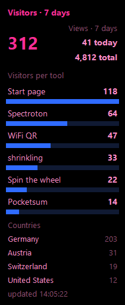

# Besucher-Ticker 📊

**Your visitor numbers in view while you work.** A small floating readout for Windows that shows the numbers of your own [GoatCounter](https://www.goatcounter.com) site live: page visits or tile clicks for the chosen period, bars per tool, plus countries or referrers. Black, pink text, blue bars.

   

[Deutsche Fassung](README.de.md) · The app speaks 14 languages.



---

## What for

The GoatCounter dashboard is for sitting down and looking at. This readout is for running alongside: it sits in a corner of your screen and answers, without you opening any page: *How many people came, and where were they?*

## Requirement

A website of your own that counts with GoatCounter. The ticker does not count anything itself, it displays what your GoatCounter account already knows. Without an account it consequently shows nothing at all.

## What it shows

| | |
|---|---|
| **Big number** | the total for the chosen period (today / 7 days / 30 days / all time), with today’s and the all-time value beside it |
| **Bars** | one bar per tool. Subpages are folded into their page, mini tiles into their tile |
| **Extra block** | countries or referrers, or off |

**What is counted** (tray menu → **Counting**):

| | |
|---|---|
| **Page visits** | visitors per page. Click events stay out, they are not pages |
| **Tile clicks** | only events whose name starts with `kachel-`: `kachel-ram` for a click on a tile, `kachel-ram-anleitung` for a mini tile inside it. That is how the [workshop](https://dennismit2n.github.io/) has reported clicks on its tiles since 12 November 2026, and nothing else. The bar is named after the title the page sends along |
| **automatic** (default) | tile clicks as soon as the site has ever reported one, page visits otherwise |

The big number is the total of all pages or of all tiles. The bars show only the biggest tools; if they all fit, together they add up to exactly that number.

GoatCounter counts *visitors*, not single views or clicks: if someone opens the same page or clicks the same tile several times during one visit, it counts once. The labels say so (up to version 1.2.0 the big number was called “Views” and also contained click events).

## Getting started

**With the prebuilt exe:** download it from the [releases](../../releases/latest), put it anywhere, double-click. On first start Windows will say "unknown publisher": the file is not signed, which costs money. Continue via **More info → Run anyway**.

**From source:**

```
pip install requests pystray pillow
pip install pywin32        (optional, encrypts the token)
pythonw besucher_ticker.py
```

**On first start** the ticker asks for two things: the address of your GoatCounter site (`yourname` is enough) and an API token. You create the token on your GoatCounter site: username in the top right → **API** → **Add new token**. Ticking **Read statistics** is enough. The ticker needs no more rights, and fewer rights can do less harm should the token ever get out.

## Controls

| | |
|---|---|
| Drag | move the overlay, the position is saved when you let go |
| Double-click | switch between small and large |
| Right-click the tray icon | overlay on/off, bring to centre, refresh now, period, extra block, counting, settings, themes, change access, language, quit |

Overlay gone? **Bring overlay to centre** in the menu. That happens when a second monitor was unplugged: the overlay is borderless and has no title bar to drag it back by.

## Privacy

**The ticker talks to exactly one address: your own GoatCounter site.** Read-only requests, no telemetry, no update check, no identifier.

The token lives in `config.json` next to the program, encrypted via Windows DPAPI when `pywin32` is installed, bound to your user account and your machine. Without `pywin32` it sits there in plain text; the program still runs, but you should know. Either way: the file stays local and does not belong in any backup others can read.

## Under the hood

One file, around 3,000 lines, three third-party packages (`requests`, `pystray`, `pillow`; `pywin32` optional), everything else is the Python standard library.

- One refresh takes 2 to 5 requests, one after another, at least 0.26 s apart. GoatCounter allows 4 per second. With tile clicks, `/stats/hits` is paged through 100 paths at a time (`exclude_paths`), at most 10 pages. Even the fastest setting (15 s) stays far below the limit, and there are deliberately no per-second settings.
- The all-time total is fetched at most every 10 minutes: it changes slowly, and every query costs a request.
- On HTTP 429 the ticker waits as long as the server asks. GoatCounter reports that in the `X-Rate-Limit-Reset` header, with `Retry-After` as the fallback.
- `python besucher_ticker.py --selbsttest` checks the arithmetic and mapping logic without network and without a window.

## License

MIT, see [LICENSE](LICENSE).

---

Besucher-Ticker is a personal tool and is **not affiliated with GoatCounter**. GoatCounter is a project by Martin Tournoij.

Part of the [workshop](https://dennismit2n.github.io/) by Dennis_mit_2n.
